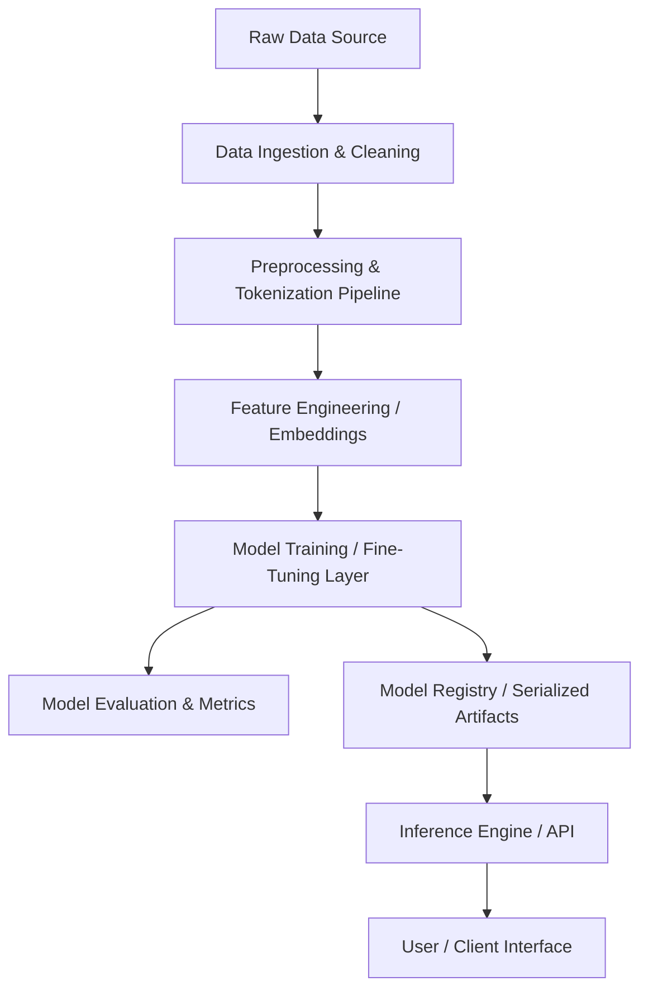

# System Architecture

## 1. Overview
This document describes the high-level architecture of the Sentiment Analysis system, detailing the components, layers, and interaction paradigms.

## 2. High-Level Architecture Diagram

## 3. Layer Breakdown
1. **Data Layer**: Responsible for data acquisition, schema validation, storage, and batching.
2. **Preprocessing Pipeline**: Text normalization, noise removal, tokenization, stemming/lemmatization, or subword tokenization.
3. **Modeling & Learning Layer**: Defines network architecture, optimization strategies, loss calculation, and backpropagation.
4. **Evaluation & Validation Layer**: Accuracy, Precision, Recall, F1-Score, ROC-AUC, and Confusion Matrix computation.
5. **Serving / Inference Layer**: Batch and real-time prediction interfaces for input text scoring.

## 4. Tech Stack & Environment
- **Language**: Python
- **Key Libraries**: NumPy, Pandas, Scikit-Learn, PyTorch / TensorFlow / Transformers (to be finalized during implementation)
- **Validation**: Pytest / Sanity checks / Metric thresholds
