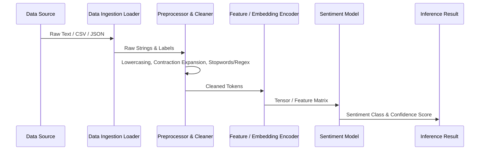

# Data Flow & Pipeline Architecture

## 1. Overview
Details how raw text data transitions through ingestion, cleaning, transformation, model consumption, and inference output.

## 2. Pipeline Flow

## 3. Data Transformations
- **Ingestion Stage**: Schema enforcement, null handling, encoding conversion (UTF-8).
- **Text Cleaning**: Strip HTML, URLs, punctuation, handle emojis, handle casing.
- **Representation Stage**: Bag-of-Words / TF-IDF / Dense Word Embeddings / Contextual Embeddings (BERT/RoBERTa).
- **Inference Flow**: Real-time raw string -> Clean string -> Encoded tensor -> Softmax logits -> Sentiment label + Probability.
